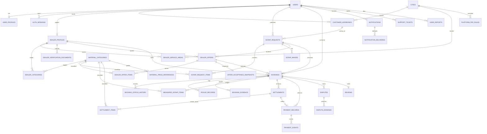

# Database

ScrapSetu uses PostgreSQL 16 in production and SQLite for zero-install local
development. Both are driven by the same SQLAlchemy 2 models and Alembic
migrations.

## 1. Conventions

| Concern | Decision |
|---|---|
| Primary keys | UUID v4 strings (`VARCHAR(36)`) generated in Python. Portable, no sequence contention, safe in URLs. |
| Money | `NUMERIC(14,2)` INR, Python `Decimal`, `ROUND_HALF_UP`. Serialized as JSON **strings**. |
| Weights | `NUMERIC(12,3)` kg. |
| Timestamps | `DATETIME` stored in UTC via a custom `UTCDateTime` type; formatted in `Asia/Kolkata` by the UI. |
| Statuses | Strings validated by `StrEnum` values, not native DB enums. Easier migrations, safer cross-database behaviour. |
| Soft delete | `deleted_at` on users, addresses, listings and images; queries filter it. |
| Audit | `audit_logs` is append-only and stores before/after JSON without secrets. |
| Naming | `snake_case` tables/columns; indexes `ix_*`, uniques `uq_*`, checks `*_valid`. |

## 2. Entity-relationship diagram (core flow)



## 3. Table catalogue (37 tables)

### Identity and access

| Table | Purpose | Notable constraints |
|---|---|---|
| `users` | One row per phone, role (`customer`/`dealer`/`admin`), status, locale. | Unique `phone`; status check. |
| `user_profiles` | Display name, email, avatar, language. | PK/FK `user_id`. |
| `otp_challenges` | Hashed OTP, purpose, expiry, attempts, resend window, IP. | `ix_otp_phone_created`. |
| `auth_sessions` | Refresh-token hash, expiry, revocation, replacement chain. | Token hash unique; family rotation. |

### Catalogue and geography

| Table | Purpose | Notable constraints |
|---|---|---|
| `cities` | Active service cities, slug, timezone, centre coordinates. | Unique `slug`. |
| `material_categories` | Scrap categories (paper, metal, e-waste, …), unit, icon, flags. | Unique `slug`. |
| `material_price_references` | Effective-dated indicative min/max rates by category and optional city. | `ix_price_ref_cat_city_effective`. |
| `platform_fee_rules` | Effective-dated percent/flat fee rules, global or per city, `applies_to` customer/dealer. | Owner FK, date range. |

### Customers and dealers

| Table | Purpose | Notable constraints |
|---|---|---|
| `customer_addresses` | Pickup addresses with contact, city, pincode, default flag. | `ix_address_customer_active`. |
| `dealer_profiles` | Business identity, GSTIN/PAN, status, capacity, rating aggregates, operating hours. | Unique `user_id`; status check. |
| `dealer_service_areas` | City + locality and/or pincode prefixes a dealer covers. | `uq_dealer_area`. |
| `dealer_categories` | Many-to-many dealer ↔ material category. | Composite PK. |
| `dealer_verification_documents` | Private KYC files with review status. | Owning dealer only. |

### Listings and offers

| Table | Purpose | Notable constraints |
|---|---|---|
| `scrap_requests` | Listing: reference, address snapshot, preferred date/window, status, expiry, offer count, version. | `ix_request_status_city_created`, `ix_request_customer_status`. |
| `scrap_request_items` | Category, estimated kg, quantity/unit, condition notes. | `uq_request_item_category`. |
| `scrap_images` | Re-encoded JPEG metadata (key, size, dimensions, order). | `ix_image_request_active`. |
| `dealer_offers` | Versioned quote per dealer: payout, min weight, pickup date/window, validity, disclosure. | `uq_offer_version`; partial unique `uq_offer_one_accepted` (one accepted offer per listing); status check. |
| `dealer_offer_items` | Per-category rate, estimated weight, computed line total. | `uq_offer_item_category`. |
| `offer_acceptance_snapshots` | Immutable JSON of the accepted offer + listing + dealer at acceptance time. | Written once; never updated. |

### Booking and fulfilment

| Table | Purpose | Notable constraints |
|---|---|---|
| `bookings` | Reference, request, customer, dealer, offer, snapshot, status, schedule, accepted payout, lifecycle timestamps, version. | **Partial unique `uq_booking_active_request`** (at most one non-cancelled/failed booking per listing); status check; indexes by dealer/customer/schedule. |
| `booking_status_history` | Every transition: from/to, actor, role, reason, metadata. | Append-only. |
| `pickup_records` | Start/completion timestamps and notes. | One or more per booking. |
| `booking_evidence` | Photos/documents with uploader and type. | Authorization-checked downloads. |
| `measured_scrap_items` | Dealer-recorded actual kg and rate per category. | `uq_measured_category`. |

### Settlement and payment

| Table | Purpose | Notable constraints |
|---|---|---|
| `settlements` | Versioned payout: gross, deductions, adjustments, platform fee, final payout, status, calculation JSON, admin adjustment metadata. | `uq_settlement_version`; status check. |
| `settlement_items` | Snapshot of accepted vs final rate, weight, line total, consent state. | One per category per version. |
| `payment_records` | Method (cash/UPI), amount, status, reference, recorder, customer confirmation. | Amounts non-negative. |
| `payment_events` | Append-only payment audit events. | Optional idempotency key. |

### Trust, support and operations

| Table | Purpose |
|---|---|
| `reviews` | One review per completed booking, 1–5 stars, moderation status. |
| `disputes` | Booking/settlement dispute, category, description, status, resolution. |
| `dispute_evidence` | Files attached by either side or admin. |
| `support_tickets` | Customer/dealer support threads with priority and resolution. |
| `user_reports` | Abuse reports against users with moderation status. |
| `notifications` | In-app notifications with dedupe key and read state. |
| `notification_deliveries` | Per-channel delivery attempts (in-app/SMS/email). |
| `audit_logs` | Actor, action, entity, before/after, reason, hashed IP, user agent. |
| `idempotency_keys` | Scoped response cache for retry-safe mutations. |

## 4. Lifecycle values

**Listing:** `draft → open → offer_selected → completed` plus `expired`,
`cancelled`.

**Offer:** `submitted`, `withdrawn`, `expired`, `accepted`, `not_selected`,
`superseded`.

**Booking:** `offer_selected`, `booking_confirmed`, `pickup_in_progress`,
`weighing_recorded`, `settlement_pending`, `disputed`, `completed`,
`cancelled`, `failed`.

**Settlement:** `draft`, `submitted`, `customer_confirmed`, `disputed`, `paid`,
`completed`, `void`.

**Payment:** `pending`, `recorded`, `confirmed`, `failed`, `disputed`
(recording is always external; `confirmed` means the customer acknowledged
receipt).

**Dispute:** `open`, `under_review`, `resolved`, `withdrawn`.

**Review:** `published`, `flagged`, `hidden`.

The API returns raw enum values; the UI maps them to human labels and uses
context-specific maps (for example `open` means “Collecting offers” for a
listing but “Open” for a dispute).

## 5. Integrity rules that matter

1. **One live booking per listing.** `uq_booking_active_request` is a partial
   unique index on `bookings.request_id` where status is not `cancelled` or
   `failed`. This is the portable guarantee behind exclusive offer acceptance.
2. **One accepted offer per listing.** `uq_offer_one_accepted` is a partial
   unique index on `dealer_offers.request_id` where status is `accepted`.
3. **One offer per dealer version.** `uq_offer_version`.
4. **One row per category** in listing items, offer items and measured items.
5. **One settlement version per booking.** `uq_settlement_version`.
6. **Money never negative.** Check constraints plus service-level validation.
7. **Completion guard.** The state machine refuses `completed` unless the latest
   settlement is customer-confirmed and confirmed payments cover the payout.
   This is enforced in code because it spans multiple tables.

## 6. Migrations

```bash
cd backend
python -m alembic upgrade head       # apply
python -m alembic revision --autogenerate -m "describe change"
python -m alembic downgrade -1       # local rollback
```

`alembic/env.py` imports the application settings, so migrations always target
the same `DATABASE_URL` as the API. SQLite runs with `render_as_batch=True` so
alterations work in both engines.

The initial migration creates all 37 tables, enums-as-checks, indexes and the
two partial unique indexes. Alembic's `version_num` is the source of truth; the
launcher runs `upgrade head` before starting the API.

## 7. SQLite vs PostgreSQL

| Area | SQLite (dev) | PostgreSQL (production) |
|---|---|---|
| Concurrency | Serialized writes; `FOR UPDATE` ignored | Row locks work; higher throughput |
| Partial indexes | Supported | Supported |
| JSON | Stored as text, queried in Python | `json`/`jsonb`-capable |
| Numeric | Stored as numeric affinity | Exact `numeric` |
| Migrations | Batch mode | Native ALTER |
| Search | `LIKE` | `LIKE`; add `pg_trgm` if needed |

SQLite is a development convenience, not a production recommendation. Always
run the test suite and smoke tests against PostgreSQL before deploying.
